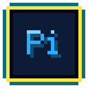
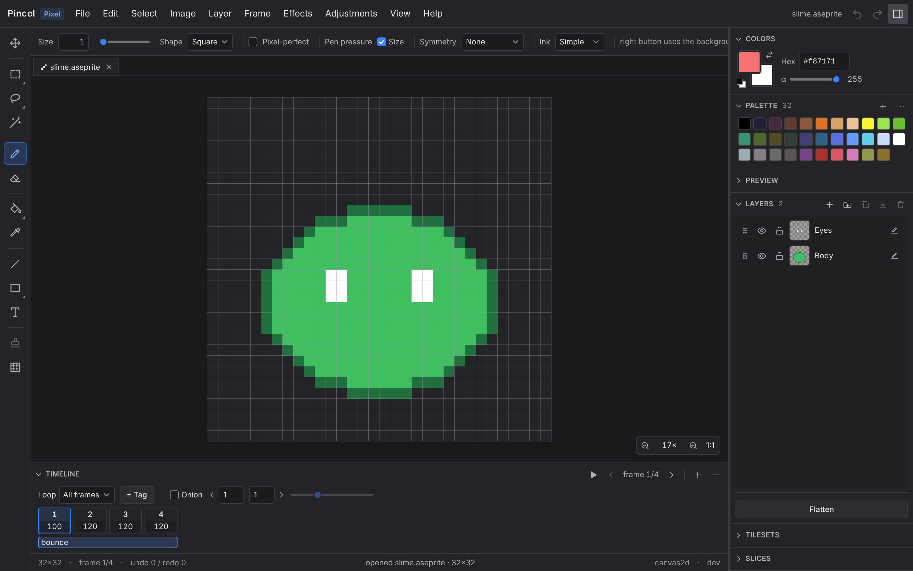

<!-- amigo-labs header: generated by amigo-labs/website scripts/readme-header.ts -->
<p align="center">
  <a href="https://amigo-labs.dev/pincel/"></a>
</p>

<h1 align="center">Pincel</h1>

<p align="center">
  <a href="https://amigo-labs.dev/pincel/"></a>
  <a href="https://github.com/amigo-labs/amigo-pincel/releases"></a>
  <a href="https://github.com/amigo-labs/amigo-pincel/actions/workflows/ci.yml"></a>
  
  <a href="https://amigo-labs.dev/pincel/"></a>
</p>
<!-- /amigo-labs header -->

Pincel is a pixel-art and image editor in one app. **Pixel mode** makes sprites, tilemaps and animations and reads and writes the `.aseprite` format. **Image mode** edits layered images — photos, screenshots, mockups — with brushes, selections, effects and adjustments. The mode follows the file you open. It runs as an installable web app and as a desktop app.



## Try it

- **In the browser:** https://pincel.amigo-labs.dev/app
- **Desktop:** installers for Windows, macOS and Linux are on the [latest release](https://github.com/amigo-labs/amigo-pincel/releases/latest). The installed app updates itself.

## Documentation

For users, on [amigo-labs.dev/pincel](https://amigo-labs.dev/pincel/):

- [About Pincel](https://amigo-labs.dev/pincel/about/) — what it is for and where it is going
- [Use Pincel from an AI agent (MCP)](https://amigo-labs.dev/pincel/mcp/)
- [Embed the editor](https://amigo-labs.dev/pincel/embed/) in your own tool

For contributors, in this repository:

- [`docs/specs/pincel.md`](docs/specs/pincel.md) — the design: what to build and why
- [`docs/specs/README.md`](docs/specs/README.md) — feature specs: what is next
- [`AGENTS.md`](AGENTS.md) — how to build it: repository layout, conventions, all commands
- [`docs/RELEASING.md`](docs/RELEASING.md) — releases

## Development

You need Rust (stable) with the `wasm32-unknown-unknown` target, [`wasm-pack`](https://rustwasm.github.io/wasm-pack/), Node 22 and [`pnpm`](https://pnpm.io/) 10. The desktop shell also needs the [Tauri 2 prerequisites](https://v2.tauri.app/start/prerequisites/).

```bash
cd ui
pnpm wasm:build     # first: the UI links the generated wasm packages
pnpm install
pnpm dev            # http://localhost:5173/app/
pnpm tauri:dev      # the desktop app
```

Tests and lints: `cargo test`, `cargo clippy` and `pnpm lint && pnpm check && pnpm build && pnpm test:e2e`, with the exact crate lists in [`AGENTS.md`](AGENTS.md) §10.

## License

Dual-licensed under [MIT](LICENSE-MIT) or [Apache-2.0](LICENSE-APACHE), at your option.

"Aseprite" is a trademark of Igara Studio S.A. Pincel is not affiliated with or endorsed by Igara Studio; it independently implements the publicly documented `.aseprite` file format.
